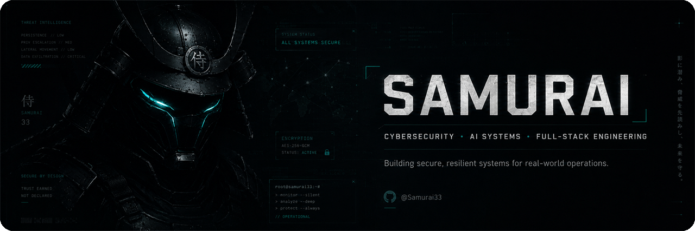

<div align="center">



### I build, secure and run software on my own infrastructure — and keep it online.

[](https://n3xus.dev)
[](https://www.linkedin.com/in/th1rangel)
[](https://status.n3xus.dev)
[](mailto:contato@n3xus.dev)

</div>

```console
$ whoami
Thiago "Samurai" Rangel — founder @N3xusD3v · São Paulo, BR

$ cat focus.txt
Self-hosted platforms · DevOps & observability · Secure AI · AppSec & pentesting · LGPD

$ cat principles.txt
Security-first · Evidence-driven · Human-in-the-loop · Production is a gate, not a vibe
```

## Live in production

Things you can open right now, running on infrastructure I built and operate.

| | What it is | Built with |
|---|---|---|
| **[CyberJust](https://cyberjus.org)** · [repo](https://github.com/Samurai33/CyberJust) | Cybersecurity media & education about real Brazilian cybercrime cases, with an AI-voiced podcast pipeline | Next.js · TypeScript · Vitest · Playwright · Python (Whisper) |
| **[status.n3xus.dev](https://status.n3xus.dev)** | Public status page for the N3XUS lab — services, databases, network and power | Prometheus · Alertmanager · Cloudflare Workers |
| **[Ops Log AI](https://opslog.n3xus.dev)** | AI-assisted aviation operations: flight logs, fuel receipts and maintenance images → human-reviewed records | TypeScript · Firebase · LLM extraction |
| **[n3xus.dev](https://n3xus.dev)** | Company site in 4 languages, including RTL Hebrew and Arabic | Astro · Tailwind · Cloudflare Pages |

## The infrastructure behind it

A small production lab, run like a real one:

- **Compute** — Proxmox VE on a Dell R730 + a self-built X99 node — ~40 monitored VMs, containers and apps
- **Deploy** — Coolify (self-hosted PaaS), Docker, deploy keys per app, nightly vzdump + off-site backups to Cloudflare R2
- **Edge & access** — Cloudflare Tunnel, Access (Zero Trust) and Workers in front of everything; nothing exposed directly
- **Observability** — Prometheus, Alertmanager and exporters for hosts, VMs, MikroTik routers and UPS; alerts to Telegram 24/7 ([open-sourced](https://github.com/Samurai33/n3xus-lab-observability))
- **Power** — UPS monitored via NUT + diesel generator, so "online" survives a blackout

## Open source you can inspect

| Project | What you can verify in the repo |
|---|---|
| **[n3xus-lab-observability](https://github.com/Samurai33/n3xus-lab-observability)** | The lab's monitoring stack, sanitized · 71 Prometheus alert rules tuned on real incidents · read-only Proxmox & MikroTik · NUT/vzdump/Docker collectors · gitleaks-checked · Docker Compose quickstart |
| **[CyberJust](https://github.com/Samurai33/CyberJust)** | Unit + E2E tests · `SECURITY.md` · 185+ issues & PRs with conventional commits · rate-limiter XFF-bypass fix · hardened headers |
| **[n3xus-video-factory](https://github.com/Samurai33/n3xus-video-factory)** | Self-hosted agentic video pipeline · n8n control plane · Docker Compose validated in CI · human review gates |
| **[Data Sentinel](https://github.com/Samurai33/delduque-data-sentinel)** | Streamlit dashboard over a sensitive Google Sheet · read-only Drive service account · Plotly · Docker |
| **[GreenPulse](https://github.com/Samurai33/GreenPulse)** | Datacenter energy & SRE dashboard · CI · `SECURITY.md` / `CONTRIBUTING.md` · explicit demo-data boundaries |

## Private work

Client or product confidentiality — architecture walkthroughs available on request.

- **🛡️ CPTS Report AI** — self-hosted pentest workspace: authorized scope, evidence, CVSS, compliance mapping, human-reviewed AI reporting
- **🔎 Public-sector security assessment (2026)** — authorized recon & vulnerability assessment with sanitized, hash-verified evidence and a remediation roadmap
- **✈️ n3xs-db** — electronic pilot logbook with digital signature (ANAC Res. 458/2017), multi-tenant, LGPD by design

## Now shipping

<!-- SHIPPING:START -->
| Repository | What it is | Stack | Last push |
|---|---|---|---|
| [CyberJust](https://github.com/Samurai33/CyberJust) | Cybersecurity media and education experience exploring Brazilian cybercrime cases, specialists and digital protection. | Python | today |
| [n3xus-lab-observability](https://github.com/Samurai33/n3xus-lab-observability) | Prometheus + Alertmanager monitoring for a self-hosted Proxmox lab: UPS (NUT), IPMI, vzdump backups, Docker, MikroTik (MKTXP), ICMP uplink probes and Proxmox→Telegram notifications. | Python | 1d ago |
| [MarolaOT-Scripts](https://github.com/Samurai33/MarolaOT-Scripts) | Reproducible automation, diagnostics and safe maintenance for MarolaOT / OTClient / vBot 4.8 — backup, rollback, PowerShell CI. | PowerShell | 1d ago |
| [VoltEra-Nexus-The-Energy-Consciousness-Protocol](https://github.com/Samurai33/VoltEra-Nexus-The-Energy-Consciousness-Protocol) | Interactive digital-art experience connecting clean energy, decentralized infrastructure and speculative technology. | TypeScript | 1d ago |
| [Kernel-Mind](https://github.com/Samurai33/Kernel-Mind) | Research and product concept for neuroscience-informed ambient soundscapes designed to support developer focus. | — | 1d ago |
<!-- SHIPPING:END -->

<details>
<summary><b>Technology map</b></summary>
<br>

| Layer | Tools |
|---|---|
| Infra & platform | Proxmox VE, Linux, Docker, Coolify, Cloudflare (Tunnel, Access, Workers, R2), MikroTik |
| Observability | Prometheus, Alertmanager, MKTXP, NUT, Telegram alerting |
| Frontend | TypeScript, React, Next.js, Astro, Vite, Tailwind CSS |
| Backend & APIs | Node.js, Python, FastAPI, Supabase, PostgreSQL, Redis, webhooks |
| AI | LLM integrations & agents, structured extraction, Whisper, local embeddings, voice pipelines |
| Security | Threat modeling, OWASP ASVS/Top 10, CVSS, recon, evidence integrity, LGPD |
| Delivery | Git, Vitest, Playwright, Dockerized local CI, technical documentation |

<p align="center">
  
</p>
</details>

## Activity

<picture>
  <source media="(prefers-color-scheme: dark)" srcset="metrics/contributions-dark.svg" />
  <source media="(prefers-color-scheme: light)" srcset="metrics/contributions.svg" />
  
</picture>

## Beyond the terminal

Helicopter flight instructor and DJ. Aviation taught me checklists, risk awareness and calm decisions under pressure; music taught me timing and how to read a live system. Both shape how I run production.

<div align="center">

**Need something built, secured or kept online?** → [contato@n3xus.dev](mailto:contato@n3xus.dev)

</div>
